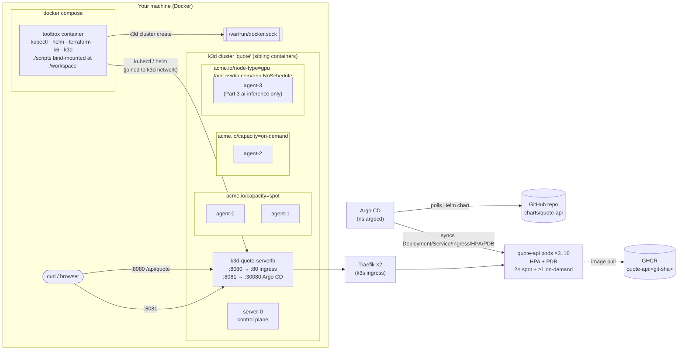
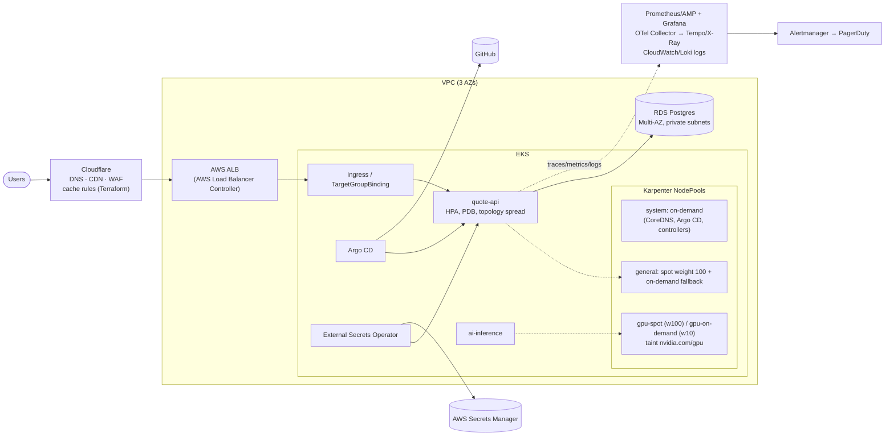

# quote-api platform: DevOps take-home

A small Go HTTP service (`quote-api`) deployed with GitOps (Argo CD + a Helm chart written from scratch) onto a local
4-worker k3d cluster that simulates spot / on-demand / GPU nodepools. The repo also includes a spot-reclaim drill, the troubleshooting
challenge, a GitHub Actions pipeline migrated from GitLab CI, Karpenter + Cloudflare IaC, and ops answers.

| Part | Status | Where |
|---|---|---|
| 1. Service + image | done | [`app/`](app/), image `ghcr.io/<owner>/quote-api:<git-sha>` |
| 2. GitOps + placement + reclaim drill | done | [`charts/quote-api/`](charts/quote-api/), [`argocd/`](argocd/), `scripts/20`, `scripts/25` |
| 3. Troubleshooting | done | [`troubleshoot/fixed-app.yaml`](troubleshoot/fixed-app.yaml), [`TROUBLESHOOTING.md`](TROUBLESHOOTING.md) |
| 4. GitLab → GitHub Actions | done | [`.github/workflows/ci.yml`](.github/workflows/ci.yml), [`MIGRATION-NOTES.md`](MIGRATION-NOTES.md) |
| 5. Karpenter + Cloudflare (validate-only) | done | [`iac/`](iac/), `scripts/50` |
| 6. Load test + observability | **not done**, see [what I cut](#what-i-cut-and-why) | |
| 7. Ops questions | done | [`OPS-ANSWERS.md`](OPS-ANSWERS.md) |
| AI usage | done | [`AI-USAGE.md`](AI-USAGE.md) |

## Quick start

Requirements: Docker (Desktop, OrbStack, or Engine) with **≥ 4 CPUs / 6 GB RAM** for Docker, and free host ports 8080 and 8081.

```bash
git clone <this-repo> && cd <this-repo>
docker compose up -d          # builds the toolbox, creates the k3d cluster, labels nodepools (~2-3 min)
./scripts/run-all.sh          # deploy via Argo CD, reclaim drill, troubleshooting, IaC validation

curl http://localhost:8080/api/quote
open http://localhost:8081    # Argo CD UI (admin password is printed by scripts/20-deploy.sh)
```

`run-all.sh` waits for the bootstrap to finish, so it is safe to run it right after `docker compose up -d`.
Each `scripts/NN-*.sh` can also be run on its own, from the host or from inside the toolbox (`docker compose exec toolbox bash`).
Every script is idempotent.

Clean up: `./scripts/99-teardown.sh && docker compose down`.

## Architecture



**Request path:** `localhost:8080` → k3d load balancer (nginx) → Traefik (2 replicas, PDB) → Service `quote-api` → pods on spot/on-demand nodes.

**Delivery path:** `git push` → GitHub Actions (Semgrep + tests + Trivy gates) → image pushed to GHCR, tagged with the git SHA, and signed with cosign
→ the bot commits the new tag to `charts/quote-api/values.yaml` → Argo CD sees the commit and rolls the Deployment. CI never talks to the cluster.

### Production on AWS (bonus)



## Script reference

| Script | What it does | When |
|---|---|---|
| `scripts/00-cluster-up.sh` | Creates/starts the k3d cluster (1 server + 4 agents, k3s v1.35.9), joins the toolbox to the cluster network, writes the kubeconfig, makes Traefik HA, runs `troubleshoot/prepare.sh`. | Automatically on `docker compose up -d` (toolbox entrypoint). Re-run manually if needed. |
| `scripts/20-deploy.sh` | Installs Argo CD (Helm chart 10.10.5) and applies the `quote-api` Application pointing at this repo's `origin`. Waits for Synced/Healthy, asserts placement, curls through the ingress. | After bootstrap. |
| `scripts/25-reclaim-drill.sh` | Runs a curl loop through the ingress, drains a spot node that hosts a replica, waits for the replacement replicas, prints scheduling events, re-asserts placement, reports failed requests (fails if > `MAX_ERRORS`, default 0), uncordons the node. | After 20. |
| `scripts/30-troubleshoot.sh` | Applies `troubleshoot/fixed-app.yaml` and runs `troubleshoot/verify.sh` (prints `PASS`). `--from-broken` first applies the original broken manifests. | Any time after bootstrap. |
| `scripts/50-validate-tf.sh` | `terraform fmt -check`, `init -backend=false`, `validate` on `iac/cloudflare`; strict kubeconform of the Karpenter manifests against the v1 CRD schemas. | Any time (no cluster needed). |
| `scripts/run-all.sh` | Waits for the bootstrap, then runs 20 → 25 → 30 → 50. | The reviewer's entry point. |
| `scripts/99-teardown.sh` | Deletes the k3d cluster (`docker compose down` alone leaves it running). | Clean-up. |

## Design decisions & trade-offs

- **k3d driven from a toolbox container through the Docker socket.** The cluster nodes are sibling containers, so `docker compose up -d` is the only command needed,
  and k3s ships NetworkPolicy enforcement, metrics-server (needed by the HPA) and Traefik. Trade-off: mounting the Docker socket gives the toolbox root-equivalent access to the host's Docker.
  That is acceptable for a local lab and not something I would do in a shared environment.
- **Placement = required affinity to {spot, on-demand} + preferred spot (weight 100) + capacity-type topology spread `maxSkew: 1, DoNotSchedule` + soft per-node spread.**
  - Why this guarantees an on-demand replica with plain scheduler primitives: at 3 replicas, "3 spot / 0 on-demand" has skew 3, so the scheduler is forced into 2 spot + 1 on-demand.
    If the on-demand pod dies, its replacement has to go back to on-demand.
  - `maxSkew: 2` looks cheaper but is wrong: after losing the on-demand pod, 2/0 is a skew of 2, which is allowed, so the replacement could land on spot.
  - Why it doesn't block rescheduling: `nodeTaintsPolicy: Honor` removes cordoned/drained nodes from the spread math. If a whole pool disappears, the survivors take every replica instead of the pods sitting in Pending.
    Per-node spread is `ScheduleAnyway`. `matchLabelKeys: [pod-template-hash]` applies the rule per ReplicaSet, so rolling updates keep it too.
  - Trade-off: at high HPA counts the capacity spread stays ~50/50, so I pay for more on-demand than strictly needed (e.g. 5 of 10).
    In production I would run a small on-demand "anchor" Deployment plus a spot-preferring Deployment behind the same Service, or use Karpenter capacity-type spread with a larger skew. I kept the single Deployment because the brief asks for one HPA with `minReplicas: 3`.
- **Graceful shutdown in the app:** on SIGTERM it fails `/readyz`, keeps serving for 5 s while endpoints and Traefik update, then drains connections.
  Together with the PDB (`maxUnavailable: 1`), `maxUnavailable: 0` rollouts and 2 Traefik replicas, this is what lets the drill demand zero failed requests (`MAX_ERRORS=0`).
- **Traefik made HA in bootstrap.** k3s ships one Traefik replica. If it sat on the drained node, the drill would measure an ingress outage instead of app availability.
- **Image tag = full git SHA, promoted by a Git commit** (bot updates `values.yaml`, Argo CD syncs). Deploys are reviewable and revertible with `git revert`, and CI holds no cluster credentials.
  `latest` is pushed only as a convenience alias and is never deployed.
- **Argo CD Application source = this repo's `origin` remote**, filled in by `20-deploy.sh`. A fork or a re-hosted clone therefore deploys its own chart with no edits (override with `REPO_URL=...`).
- **Go + distroless static (`nonroot`, UID 65532):** the image is ~10 MB with no shell, and runs with a read-only root filesystem with no writable volumes. It is multi-arch (amd64 + arm64), so it works on Apple Silicon.
- **Pinned versions everywhere** (k3s, kubectl, helm, Argo CD chart, Terraform provider, GitHub Actions pinned by commit SHA). I looked up the current releases rather than trusting memory.

### What I cut, and why

- **Part 6 (k6 + Prometheus/Grafana).** I prioritised doing CORE, Part 4 and Part 5 properly. The groundwork is in place: `/metrics` exposes a request counter and a latency histogram,
  pods carry scrape annotations, k6 is in the toolbox, and the app burns ~100 ms CPU per request so the HPA can be driven.
- **Toolbox image is built locally** (`build:` in compose) rather than pulled from GHCR. This adds ~1 min on first start but avoids a second release pipeline. The app image is on GHCR as required.
- **No TLS / auth on the lab ingress and Argo CD UI.** Lab only. In production TLS terminates at Cloudflare and the ALB, and Argo CD sits behind SSO.
- **No ServiceMonitor / NetworkPolicies for quote-api itself.** Out of scope for the brief. The Part 3 work shows the NetworkPolicy approach.

## Findings about the provided files

Treated as an imperfect handoff. Each finding has a decision:

1. **`prepare.sh` picks "worker nodes" by an empty `node-role.kubernetes.io/control-plane` label value.** k3s sets that label to `"true"`, so it works here. On **kind** the label value is `""`,
   which would label the control-plane node as a spot node. I chose k3d partly for this reason, used the script unmodified as instructed, and documented the trap.
2. **`prepare.sh` assigns pools by `kubectl get nodes` order** (alphabetical). With k3d's names, `agent-0/1` are spot, `agent-2` is on-demand and `agent-3` is GPU.
   It is deterministic, but adding a fifth agent leaves it unlabeled. The chart's required node affinity keeps quote-api off unlabeled nodes.
3. **`prepare.sh` says "run ONCE"**, but every command uses `--overwrite`, so re-running it on each bootstrap is safe. It is idempotent, as the Golden Rule requires.
4. **`broken-app.yaml` had 8 independent faults**, including one that only shows up after the others are fixed (NetworkPolicy blocking DNS). See [`TROUBLESHOOTING.md`](TROUBLESHOOTING.md).
5. **`legacy.gitlab-ci.yml` hard-codes AWS keys** (AWS documentation example values) and has a quality gate that can never fail. Handled in [`MIGRATION-NOTES.md`](MIGRATION-NOTES.md).
   - Decision: the two key values are **redacted** in this repo (`<REDACTED: …>`); the rest of the file is verbatim.
   - The brief says "do not commit secrets of any kind". Example values are still credential-shaped and trip secret scanners, and once committed they live in Git history forever.

## Troubleshooting notes (reviewer machine)

| Symptom | Cause | Fix |
|---|---|---|
| `port is already allocated` on `docker compose up` / bootstrap fails | 8080 or 8081 already used on the host | `./scripts/99-teardown.sh; HTTP_PORT=9080 ARGOCD_PORT=9081 docker compose up -d --force-recreate` |
| Bootstrap stuck / pods `Pending` with `Insufficient cpu/memory` | Docker VM too small for 5 k3s nodes + Argo CD | Give Docker ≥ 4 CPUs / 6 GB (Docker Desktop → Settings → Resources) |
| `Cannot connect to the Docker daemon` inside toolbox | The daemon's socket is not at `/var/run/docker.sock` *as seen by the daemon* (rootless Docker on Linux). Docker Desktop, OrbStack and Colima all work with the default, because the bind-mount path is resolved inside their VM, not on macOS. | Rootless: `DOCKER_SOCK=$XDG_RUNTIME_DIR/docker.sock docker compose up -d` |
| `ImagePullBackOff` on quote-api | GHCR package still private, or the first CI run hasn't finished | Make the package public (GitHub → Packages → quote-api → Settings → Visibility); check the Actions tab |
| `run-all.sh` says bootstrap failed | See the log | `docker compose logs toolbox`; re-run with `docker compose restart toolbox` |

Apple Silicon works: the app image is multi-arch and the toolbox downloads binaries for the build architecture.

## Maintainer setup (one-time, not needed by the reviewer)

1. Create a **public** GitHub repo and push `main`. The workflow builds `ghcr.io/<owner>/quote-api:<sha>` and commits the tag to `charts/quote-api/values.yaml`.
2. GitHub → your profile → Packages → `quote-api` → Package settings → **Change visibility → Public**.
3. Make sure no branch protection blocks `github-actions[bot]` from pushing to `main`, or switch the `deploy` job to open a PR.
